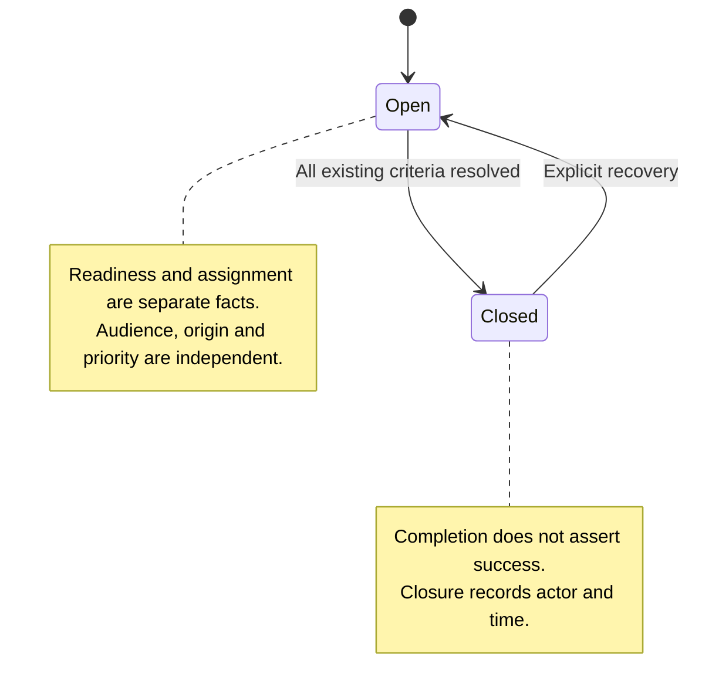
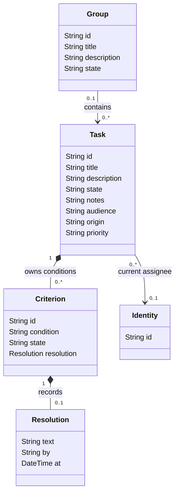
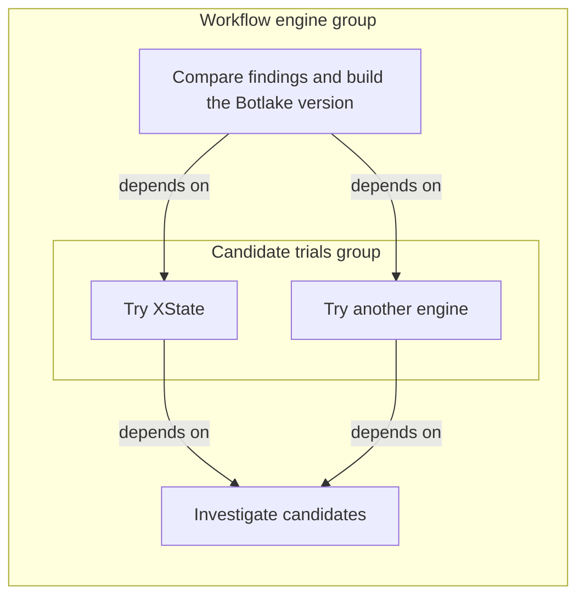
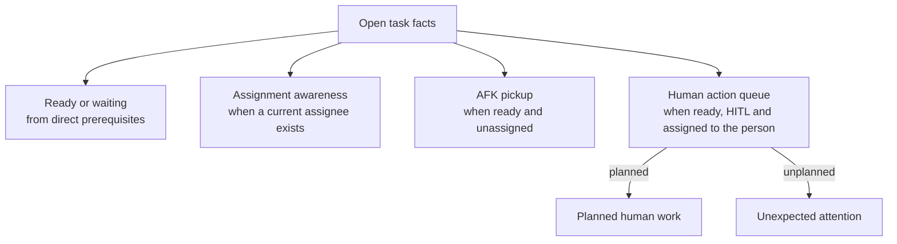
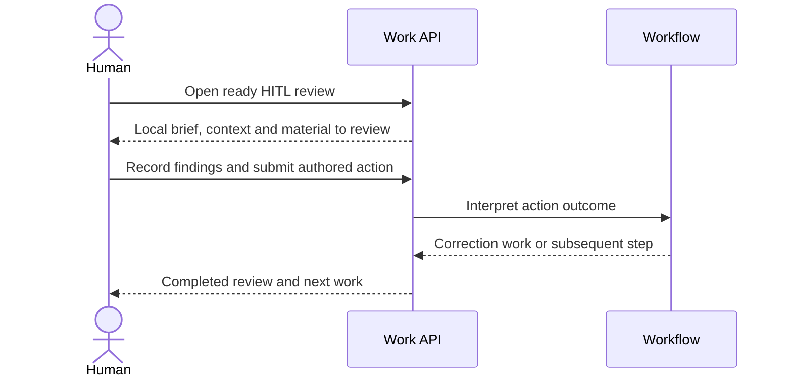

# Work coordination PRD

Status: approved for implementation, including decisions D1–D5 below. Date: 30 October 2026.

Replace the work-coordination model previously expressed through Kanban with a small set of tasks, context groups, and dependencies. Let agents organize and execute work autonomously while making current work, human requests, and upcoming work visible. Optional workflows add repeatable control flow through explicit action outcomes.

This is a fresh product specification derived from the workshop dialogue. Existing commands, schemas, behaviour, and feature parity are not requirements. User review approved implementation and the decision contracts below. Historical review notes describe the earlier draft, not compatibility requirements.

## Product principles

1. Use familiar concepts with terse guidance. Avoid requiring every agent to learn a long bespoke schema.
2. A task expresses work; a group supplies shared context and organization. Only tasks are actionable.
3. Keep lifecycle, readiness, assignment, human involvement, origin, and priority distinct. Views compose those facts instead of forcing a board-stage sequence.
4. Preserve useful conclusions and explicit changes of scope. Do not require an exhaustive transcript or event-sourced reconstruction of agent execution.
5. Enforce the few chosen invariants programmatically. Leave downstream agents responsible for interpreting findings and adapting their work.

## Task model

One task model covers questions, investigations, prototypes, implementation, bug fixes, code reviews, and organizational work. No epic, feature, investigation, or review subtype is required.

The following names describe the proposed logical API. They do not prescribe physical attribute storage or require Core nodes to become task-specific.

| Field | Meaning | Values or policy |
| --- | --- | --- |
| id | Stable identity | Assigned by the system |
| kind | Distinguish work from context | task; context records use group |
| title | Identify the work | Short text |
| description | What the task is about and its intended outcome | Local scope, context, and constraints |
| state | Whether work remains outstanding | open or closed |
| notes | Conclusions, findings, results, supporting references, or why work ended | Optional text |
| acceptanceCriteria | How completion is judged | Optional collection; see criterion contract |
| assignee | Current responsible participant | One identity or none |
| audience | Whether work can proceed unattended | AFK or HITL; defaults to AFK |
| origin | Expected work or an unexpected interruption | planned or unplanned; defaults to planned |
| priority | Independent urgency for ordering and notifications | P0 through P4; defaults to P2; P0 is immediate attention |

Audience is participation mode, not an approval verdict. Origin describes how the work arose, not how early it was created: a review created at the last minute can still be planned. Priority must not be inferred solely from origin, audience, or nesting depth.

D3 selects planned origin and P2 priority by default. P1 through P4 express decreasing urgency after P0, without introducing an SLA or a new lifecycle. Notification delivery is deferred.

### Lifecycle and closure

R1. A task starts open. Closed means no further action is expected on that task. It does not necessarily mean the hoped-for result was achieved or a change was approved.

R2. Acceptance criteria may be absent at creation and closure. Every criterion that has been added must be resolved before closure. Open criteria constrain closure, not readiness to start doing the work.

R3. Record who closed a task and when automatically. Do not require a second free-text close-reason field. Notes can explain results or why work stopped. Do not require an overall success/abandonment enumeration merely to compensate for possible judgement errors.

R4. Closing a prerequisite can affect readiness; it must not automatically close dependent tasks or resolve their criteria. Agents inspect the actual findings and determine what to do next.

D4 permits explicit reopening for recovery, with actor, time and reason retained. Prior criterion resolutions remain intact until explicitly corrected or reopened; corrections append assessments rather than erasing earlier ones. New scope after completed work normally becomes a new task, preserving the original result.



For tasks, the universal closure requirement is the criterion rule. Readiness governs pickup; it is not an additional universal closure guard. Contextual placement, open siblings, or an unfinished group do not prevent a leaf task from closing. Workflow-owned completion can impose its explicit action contract.

### Acceptance criteria

R5. Each criterion has an identifiable condition, state open or resolved, and an explicit resolution when resolved. A resolution can explain that the condition was met, was unmet, or is no longer required. These explanations are not another fixed status enumeration.

R6. Once added, preserve the original condition and its history. Normal APIs cannot silently delete or rewrite it to bypass closure. Retire a condition with an explicit resolution and append a replacement when appropriate. This is append-only preservation of conditions, not a prohibition on resolving them.

R7. The authoring agent, another agent, or a person may assess criteria. The starting product does not impose an independent-verifier role. Attribution and history provide visibility, not proof that every judgement was correct.

The API must hide whether criteria are embedded data or separate graph records. Corrections retain prior assessments and may annotate closed work without changing its lifecycle. Explicitly reopening a criterion requires an open task and restores its closure constraint. Storage remains an implementation choice. Notes are not required to be append-only merely because criteria are.

## Groups and relationships

R8. A group is a non-actionable context and organization record with a title and optional description. A group cannot be claimed or assigned as executable work. It starts open and may explicitly close only after all contained tasks, including those in nested groups, are closed. Nested groups need not themselves be closed. Group closure does not cascade or assert success. Reopen closed containing groups before adding or reopening an open task beneath them. Retrospective placement of already-closed work is allowed.

R9. Only groups can be contextual parents. A group may contain groups and tasks. Tasks are leaves and contain neither tasks nor groups. Each group or task has at most one contextual parent; roots have none. Contextual containment is acyclic.

R10. Other references may be numerous and do not add inherited instructions. Finding an investigation through another group or a search result must reveal the same contextual home, not a different brief.

R11. Inspecting a task must expose its local brief and ancestor context without requiring copied instructions in every task. Context groups may be introduced retrospectively. Keep normal reads compact; deeper context and full findings can be expanded when needed. Do not invent a fixed depth limit before real examples require one.

R12. Dependencies connect tasks or groups independently of the context tree and may cross groups. They express prerequisites, not parenthood. A task or group may be a prerequisite for many tasks or groups while retaining one contextual parent. Dependency cycles are invalid. Dependencies are direct: a group dependency does not silently create dependencies on its members.

Contextual containment alone does not gate leaf-task closure. Group closure requires all descendant tasks to be closed, under D1.

| Relationship | Direction and cardinality | Effect |
| --- | --- | --- |
| parent-of | Group to group/task; at most one incoming contextual parent per item | Shared context; acyclic |
| depends-on | Task/group to prerequisite task/group; many incoming and outgoing links | Readiness; acyclic |
| references | Task/group to related task/group; many incoming and outgoing links | Useful connection; no inherited instructions or readiness effect |

References is a proposed API spelling for the arbitrary non-contextual links discussed by the user. Reference cycles do not create context or dependency cycles.



The UML shows record ownership and assignment. Resolution is value data, not another assignable item. Composition does not decide physical storage. The relationship table defines group nesting, dependencies, and references; the parallel example below illustrates nesting and dependencies. Multiple dependencies/references do not create multiple contextual parents; the context and dependency relations remain independently acyclic.

### Example parallel investigation

The following arrows show stored dependency direction: dependent to prerequisite. The enclosing boxes show contextual grouping, not execution order.



Both trials can run in parallel after the initial investigation closes. The delivery task becomes ready when both trials close, then interprets their findings. Neither a closed trial nor readiness guarantees that a candidate was suitable.

Groups may summarize member progress. A task or group can depend on explicit group closure; closing every task does not automatically close the group.

### Scope changes and delegation

R13. Preserve completed work as its own record. A completed spike followed by production hardening becomes new work linked to the same context, not a rewrite of the spike's original purpose or results.

R14. When a task becomes too large, agents may create a group and new leaf tasks. Preserve the original task record and its notes and criterion history. Closing the original still requires explicit resolutions of its criteria; they do not move onto a non-actionable group.

Keeping the original delivery task with scout siblings is another authoring example, not a required conversion protocol. Normal create/link/move/close operations may suffice; no dedicated task-to-group transformation API is required. A group never inherits an executable assignment.

R15. A task is an obligation; an agent run is an attempt to work on it. Run completion or exit does not automatically complete the task. Task-linked spawning is a useful future integration, not a requirement to manufacture a task for every brief helper invocation.

## Readiness, assignment and blockers

R16. Readiness is derived. A task or group is ready when it is open and all its directly linked prerequisite tasks or groups are closed. It does not recursively prove the outcomes or original prerequisites of already closed work. Readiness means prerequisite work has been settled so an agent can evaluate the next action, not that every prerequisite succeeded.

R17. Use ordinary prerequisite tasks for impediments first. For example, Build the engine can depend on Enable VPN access. The prerequisite has its own brief, assignee, notes, audience, origin, and priority. Several tasks can wait on the same prerequisite. No second blocker type or independently maintained blocked Boolean is needed for this model.

R18. If a prerequisite was incorrectly closed or had an unfavourable result, downstream agents read the findings and readjust: continue differently, reopen appropriate work, create follow-on work, or stop with an explanation. Do not add success-sensitive dependency states to solve this hypothetical failure before observed cases justify them.

R19. Keep at most one current assignee and enforce claims programmatically. Agents owns run/custody evidence; Work owns assignments; Work Agents uses that evidence to release the matching assignment. Managed custody settlement or a reported external native session end permits release. Elapsed silence triggers rechecking, never release by itself. Retain assignment history. Release does not close work, resolve criteria, or remove dependencies. Human assignments use explicit release and are not subject to automatic agent expiry.

The 31 October follow-up replaces the draft's silence-based heartbeat expiry. Stalled/zombie-agent policy remains deferred. Explicit assignment-to-run binding remains the current integration contract.

Implementation consideration: concurrent claims and delayed liveness events must not overwrite a newer current assignment. Assignment-token and managed-invocation checks fence release. Native recheck cadence and any future stalled-work policy remain configuration/design decisions, not more task statuses. Assignment records responsibility or reservation and is not proof of execution.

### Derived views

| View                            | Predicate or interpretation                       |
| ------------------------------- | ------------------------------------------------- |
| Ready                           | Open with all direct prerequisites closed         |
| Available for unattended pickup | Ready, unassigned, audience AFK                   |
| Assigned work                   | Open with a current assignee; may also be waiting |
| Waiting or blocked              | Open with an unresolved direct prerequisite       |
| Human action queue              | Open, ready, HITL, assigned to the viewing person |
| Planned human work              | Human action queue with origin planned            |
| Unexpected attention            | Human action queue with origin unplanned          |

These are overlapping projections, not stored lifecycle stages. Audience controls unattended dispatch eligibility, not graph readiness. D2 routes HITL work using the human assignee; an assisting agent does not occupy that field.

The awareness view shows outstanding assigned work, its assignee, and whether it is ready or waiting. Owned-but-waiting work remains visible. Stronger live-activity observations, when available, are separate from assignment; do not label a reservation as proof of current execution. Upcoming-work views expose ready work and context, ordered using priority.



Each branch is an independent projection. A task can be assigned and waiting, or assigned and ready for human participation.

Priority is available to order views and inform notification policy independently of origin. P0 expresses immediate attention; unplanned does not automatically imply P0. Channels, delivery triggers, and preferences are not specified here. No acknowledgement state is required: resolve the actual need.

## Human checkpoints and code review

R20. A planned design conversation or code review is an ordinary HITL task. An unexpected request such as Enable VPN access is an ordinary HITL task with unplanned origin. Keep the delivery task AFK when only a focused prerequisite requires the human.

R21. A ready HITL review surfaces in its human assignee’s queue. D2 selects this simple routing contract without a second actor field; multi-human routing is deferred. The human should not have to infer readiness from a board lane or an agent's chat transcript.

R22. Review completion means the review was performed, not that the code was approved. Findings belong in notes; criteria describe the evaluation to perform. An agent review can be AFK; human participation is HITL.

Recording findings is the expected deliverable, not a hidden global note-presence check. If enforcement is needed, author a criterion such as Record review findings or require output through the workflow action schema. Otherwise, ordinary zero-criterion closure remains valid.

R23. Constrain the relevant action at the relevant boundary. A requirement for human approval before merge must not prevent implementation, preparation of a pull request, or completion of an honest review. Approval/merge policy belongs in an explicit checkpoint or workflow operation, not an ambiguous global prose stop instruction.

The product supports checkpoints across groups and further fan-out afterward. A checkpoint can depend on explicit delivery tasks or on explicit closure of the required groups.

For example, a planned HITL review depends on the required terminal delivery tasks of the front-end and back-end groups. Later tasks can depend on the review or be created from its workflow outcome. This expresses known required scope; it does not define completion of every present or future group member.

## Workflow composition

R24. Workflows operate on the same task/group model. Generated workers are actionable leaf tasks; meaningful context uses groups. Avoid a duplicate public task or ownership ledger.

R25. Workflow-generated work respects the same containment rules. Internal flow nesting does not authorize task-to-task contextual containment. Execution membership uses private workflow links, separately from contextual containment. Each run publishes a context group under an optional existing group; internal worker nesting is flattened to the nearest context group.

R26. Workflows use their authored action choices and payloads for branching, joins, and revision. Those outcomes are separate from generic task lifecycle. Closed or a criterion resolution cannot silently stand in for approval.

R27. The user described a review/revision process creating new follow-up tasks while retaining earlier findings. Completion of an agent run does not itself complete a task or submit a workflow action.

D5 selects an explicit authored action that atomically records its result, closes its worker task, checkpoints execution and publishes subsequent work. Ordinary task closure never submits an action or advances execution. Matching original-payload retries are idempotent; conflicting retries fail. Revision creates fresh tasks and retains earlier findings. Workflow-generated audience and assignment are authored task metadata, with ordinary Work defaults when omitted.



The run is a private execution record, not another business task. Run completion does not close an enclosing business group or task. Context groups may outlive execution when ordinary contained tasks remain open. Generic closure does not cancel or replan execution; cancellation and replanning commands are deferred. Consumed workflow visits remain closed; revisions publish fresh visits.

## Illustrative JSON contracts

The examples are logical API shapes for review, not a physical storage specification. Context and dependency links have one graph source of truth. Identities and times are illustrative. AFK/planned/P2 are the selected defaults.

### Context group

```json
{
  "id": "group-workflows",
  "kind": "group",
  "state": "open",
  "title": "Workflow engine",
  "description": "Build a reusable engine for runnable, user-owned workflows in Botlake."
}
```

There is no executable assignee or task criterion list on this group. Its explicit closure requires all descendant tasks to be closed.

### Delivery task

```json
{
  "id": "task-demo",
  "kind": "task",
  "title": "Build a runnable workflow proof of concept",
  "description": "Use the candidate investigations to produce and demonstrate the selected approach.",
  "state": "open",
  "notes": "Candidate research has identified two viable approaches. Prototype work is still pending.",
  "acceptanceCriteria": [
    {
      "id": "criterion-demo",
      "condition": "Provide a runnable example and record how to exercise it.",
      "state": "open"
    }
  ],
  "assignee": "identity-builder",
  "audience": "AFK",
  "origin": "planned",
  "priority": "P2"
}
```

### Human prerequisite and graph links

```json
{
  "task": {
    "id": "task-vpn",
    "kind": "task",
    "title": "Enable VPN access for the workflow demonstration",
    "description": "The demonstration needs the remote environment. Enable access or record the decision so the delivery agent can readjust.",
    "state": "open",
    "acceptanceCriteria": [],
    "assignee": "identity-requester",
    "audience": "HITL",
    "origin": "unplanned",
    "priority": "P1"
  },
  "edges": [
    {
      "from": "group-workflows",
      "to": "task-demo",
      "relation": "parent-of"
    },
    {
      "from": "group-workflows",
      "to": "task-vpn",
      "relation": "parent-of"
    },
    {
      "from": "task-demo",
      "to": "task-vpn",
      "relation": "depends-on"
    }
  ]
}
```

The delivery task remains open and becomes unready. Its owner can release the assignment, changing assignee to null; it still cannot be picked up while the prerequisite is open. The human-assignee example uses the selected D2 routing contract.

### Context and reference projection

The following supplementary read fields appear alongside the task. They do not duplicate stored briefs or readiness.

```json
{
  "taskId": "task-demo",
  "context": [
    {
      "id": "group-workflows",
      "title": "Workflow engine",
      "description": "Build a reusable engine for runnable, user-owned workflows in Botlake."
    }
  ],
  "ready": false,
  "prerequisites": [
    {
      "id": "task-vpn",
      "title": "Enable VPN access for the workflow demonstration",
      "state": "open"
    }
  ],
  "references": [
    {
      "id": "task-earlier-spike",
      "title": "Earlier workflow feasibility spike",
      "state": "closed"
    }
  ]
}
```

The historical connection can be retained using the proposed reference spelling:

```json
{
  "from": "task-demo",
  "to": "task-earlier-spike",
  "relation": "references"
}
```

### Cross-group human checkpoint

The prerequisite IDs below identify the required terminal delivery tasks of two groups. They do not implicitly depend on all members.

```json
{
  "task": {
    "id": "task-progress-review",
    "kind": "task",
    "title": "Review the front-end and back-end deliveries",
    "description": "Inspect both required deliveries and record the decision before follow-on work.",
    "state": "open",
    "assignee": "identity-requester",
    "audience": "HITL",
    "origin": "planned",
    "priority": "P1"
  },
  "edges": [
    {
      "from": "task-progress-review",
      "to": "task-frontend-delivery",
      "relation": "depends-on"
    },
    {
      "from": "task-progress-review",
      "to": "task-backend-delivery",
      "relation": "depends-on"
    }
  ]
}
```

### Retained criterion resolution

```json
{
  "id": "criterion-demo",
  "condition": "Provide a runnable example and record how to exercise it.",
  "state": "resolved",
  "resolution": {
    "text": "Met. The runnable example and exercise instructions are linked in the task notes.",
    "by": "identity-reviewer",
    "at": "2026-10-30T18:00:00Z"
  }
}
```

The original condition remains intact. The resolution text is flexible; it is not constrained to a passed/failed status list. Attribution/time are proposed logical fields, not a requirement for a particular record layout.

### Workflow review action

```json
{
  "taskId": "task-review-visit-1",
  "choice": "revise",
  "data": {
    "summary": "Address the recorded findings before another review."
  }
}
```

The review task can close with findings in notes. The workflow consumes the explicit revise action and can create correction work and a fresh review task. No generic task state named rejected or approved is required.

Automatic closure metadata can appear in a read view without another user-authored reason field:

```json
{
  "taskId": "task-review-visit-1",
  "state": "closed",
  "notes": "Changes requested. Findings and follow-up work are linked here.",
  "closedBy": "identity-requester",
  "closedAt": "2026-10-30T18:05:00Z"
}
```

## Search and API ergonomics

R28. Search previous task descriptions and notes, including closed work, so investigations can reuse findings. Searching titles and group descriptions is a useful ergonomic extension to evaluate.

R29. Search discovers possible relevance; references retain connections; groups supply context; dependencies express prerequisites. Search results do not create membership or execution obligations.

R30. Keep the public API small, machine-readable, and independent of physical storage. In particular, adding/resolving criteria must not require knowing whether they occupy embedded attributes or graph records.

R31. Task inspection supplies its local brief and relevant ancestor context without copied instructions. Criteria, notes, dependency information, and references must be accessible. Group inspection exposes its shared brief and immediate member tasks/groups, including their summaries. Compact summaries and nested-group expansion are recommended ergonomics for avoiding noise, not a selected endpoint inventory or mandatory response layout.

Terse guidance is sufficient: description says what the work is about; criteria explain completion; notes hold conclusions/findings/results. Diary can hold optional working history, while useful conclusions belong on the task.

## Acceptance scenarios

| Scenario | Required behaviour |
| --- | --- |
| An investigation needs only a supported answer | Create without criteria, record findings in notes, and permit closure without a fabricated checklist |
| A criterion is added during work | Preserve it and require resolution before closure; it does not prevent work starting |
| Scope removes a criterion | Retain the condition and its explicit resolution, appending a replacement if needed |
| A group is claimed or a task is made a contextual parent | Reject the invalid operation |
| A leaf closes while other members remain open | Permit closure when its own criteria are resolved; no implicit sibling/group gate |
| A group is closed while a nested task remains open | Reject closure until every descendant task is closed |
| A task or group depends on a group | Remain unready until that prerequisite group explicitly closes |
| Work is found through a reference | Reveal its same contextual home without inheriting another brief |
| Context is added retrospectively | Member inspection reveals the common brief without copying it into every task |
| Parallel trials precede a join | Trials proceed independently; the join waits for both to close and interprets their findings |
| A prerequisite closes unfavourably | Recalculate readiness without closing dependents or resolving their criteria |
| Assigned work gains a prerequisite | Show it in both assignment awareness and waiting views; later assignment release preserves prerequisites |
| Managed custody settles or an external native session reports ending | Release only its matching current assignment, retain history, and preserve task state, criteria and dependencies |
| An agent remains quiet beyond the recheck interval | Preserve assignment; inspect current Agents evidence without inferring exit from silence |
| Human-only VPN action is needed | Create an unplanned HITL prerequisite; exclude the human task and its unready dependents from unattended pickup |
| A planned human review becomes ready | Surface it in its human assignee’s queue, with context and priority |
| A review finds defects | Review can complete with findings; authored outcomes can create corrections or further review |
| Findings must be enforced | Use an explicit criterion or workflow output requirement; no hidden global notes guard |
| Work in two groups needs a checkpoint | A HITL review depends on the explicitly required delivery tasks, then its result informs subsequent work |
| Approval applies only before merge | Permit implementation, PR preparation and honest review beforehand; gate the relevant boundary |
| A completed spike gains production scope | Preserve its result and create new work |
| Priority differs from origin | A high-priority planned handoff can rank above a low-priority interruption without changing lifecycle |
| A criterion resolves as unmet or no longer required | Preserve its explanation; ordinary closure is allowed once all existing criteria are resolved |
| A workflow interprets a review | Branch using the authored action outcome, not generic closed state |

Success-sensitive dependency guarantees, mandatory review types, and additional lifecycle stages are deliberately not inferred from these examples.

## Approved implementation decisions

User review selected D1 and D2 explicitly and approved the discussed recommendations for D3–D5. These replace the draft’s open questions; old behaviour is not a compatibility contract.

| Decision | Selected contract |
| --- | --- |
| D1 Group lifecycle and checkpoints | Groups may close after all descendant tasks close, and may block tasks or groups through explicit dependencies. No automatic cascade. |
| D2 Intended human | HITL routes through the human assignee. Human release is explicit; agent liveness does not expire human assignments. |
| D3 Defaults and notifications | AFK/planned/P2 defaults. P0 immediate, P1–P4 decreasing urgency. Notification delivery deferred. |
| D4 Correction and recovery | Explicit recovery reopening retains conditions, resolutions and closure history. Criterion corrections append assessments; criterion reopening is explicit. Notes remain replaceable. |
| D5 Workflow execution contract | Explicit action atomically closes its task, checkpoints and publishes next work. Generic closure never advances a flow. Matching retries are idempotent; revisions create fresh visits. Execution membership is private, separate from context. Context groups may outlive runs; cancellation/replanning deferred. |

The dependency contract permits task/group endpoints in both directions. Only tasks are actionable, regardless of dependency readiness.

Criteria/assignment storage and an exact API inventory are implementation design behind the small public model, not reasons to add more types or statuses.

## Intent trace and review scope

The review packet preserves the full spoken and written dialogue with source-segment identifiers. These anchors identify the decisive user statements; neighbouring dialogue provides context.

| Requirement area | User source segments |
| --- | --- |
| Simplicity, composed views and a fresh model | V005-V009, V017, V173, V175, V298 |
| Optional criteria/notes and retained conditions | V173, superseding the minimum-one proposal at V129 |
| No duplicate close-reason field | V178, V181 |
| Single contextual parent and task leaves | V198, V208, V210 |
| Shared context without repetition | V065-V071, V193, V195 |
| Search and reuse of prior findings | V181 |
| Parallel work, dependencies and delegation | V206, V208, V224-V229 |
| Group completion | V240 originally deferred; subsequent D1 approval selects closure and group dependencies |
| Programmatic assignee release and history | V248-V262 |
| Ordinary blocker tasks and deferred success gates | V271, V274, V276 |
| AFK/HITL and planned/unplanned origin | V037, V039, V280, V285 |
| Review closure versus workflow outcome | V289, V291 |
| Approval at the relevant boundary | V264, V283-V291 |
| Priority as first-class | V046, V294 |

Independent Sol, Astra, and DeepSeek reviews compared this PRD against the dialogue for omitted intent, unsupported assumptions, unnecessary abstractions, and inconsistent JSON/diagrams. The [review ledger](work-coordination-reviews.md) records findings, dispositions, and verification. Prior code/history investigations may inform questions but do not impose compatibility requirements or establish that historical agents would have performed better.

Implementation is approved. Migration, feature parity with old Kanban, new task-type taxonomies, success-aware dependency types, mandatory tasks for every helper run, and universal notification integrations remain outside scope.
