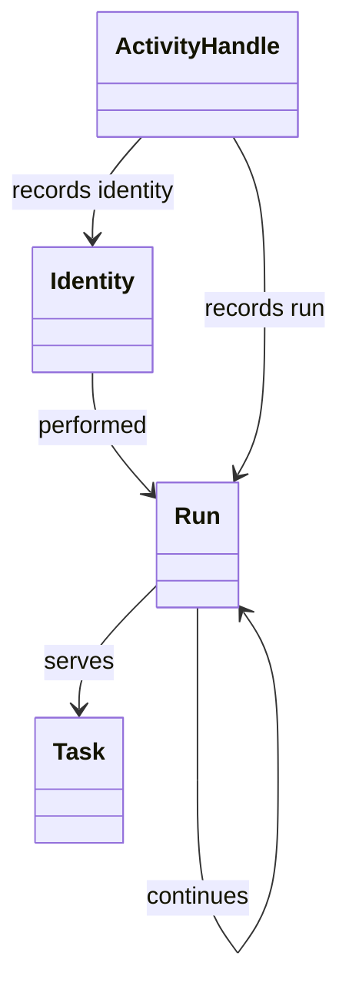
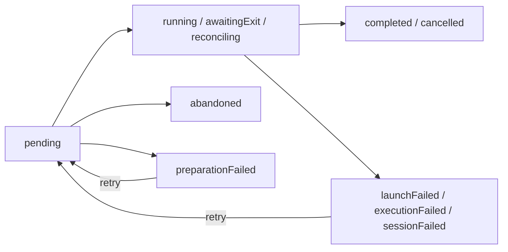

# @botlake/extension-agents

Tracked headless agent runs, providers, documented aliases, assignment, resume/retry and custody reconciliation. Install the `@botlake/core`, `@botlake/extension-identity` and `@botlake/extension-flags` peers; explicitly select Identity and Flags alongside this extension. Botlake supplies process custody.

Select `"@botlake/extension-agents"` for Codex, Pi and Claude defaults. For configuration, select a local module instead:

```ts
import { agents } from "@botlake/extension-agents";

import { modelFlags } from "./flags.ts";

export default agents({
  aliases: {
    sol: {
      doc: "Complex implementation and debugging.",
      parent: "pi",
      model: "openai-codex/gpt-5.6-sol",
      effort: "low",
      when: modelFlags.openai.name,
    },
    opus: {
      doc: "Greenfield features, API design and critical review.",
      parent: "claude",
      model: "opus",
      when: modelFlags.anthropic.name,
    },
    reviewer: ["sol", "opus"],
  },
});
```

In a separate selected [Flags module](../flags/README.md), import Agents' provider definitions and configure workspace defaults:

```ts
import { agentFlags } from "@botlake/extension-agents";
import { configureFlags, flags } from "@botlake/extension-flags";

export const modelFlags = flags({
  openai: {
    name: "model/openai",
    description: "Enable OpenAI model seats.",
    default: true,
  },
  anthropic: {
    name: "model/anthropic",
    description: "Enable Anthropic model seats.",
    default: true,
  },
});

export default configureFlags([
  [agentFlags.codex, true],
  [agentFlags.pi, true],
  [agentFlags.claude, false],
  [modelFlags.openai, true],
  [modelFlags.anthropic, true],
]);
```

`agentFlags.codex`, `agentFlags.pi` and `agentFlags.claude` own their provider flag names, descriptions and disabled defaults. Providers are opt-in: configure each desired provider with `[definition, true]`. Every `configureFlags` entry requires an explicit boolean, so an author's default changes cannot alter configured choices. Importing definitions does not activate Agents.

Database flag overrides survive restarts; `bl flag reset NAME` restores its configured default. Unconfigured or persistently unset provider flags disable the provider. Unset custom flags are false in alias conditions.

## Catalog and routing

- `parent` names a provider or alias. Nearest child model/effort/extraArgs settings replace their parent's. `systemPrompt` never inherits. A concrete `provider` descriptor also works.
- An alias can be a descriptor, another seat's name, or a nonempty ordered array of either. The first candidate whose condition and parent chain are available wins. Missing parents, cycles and disabled flags produce visible unavailability reasons. Fallback selects before launch; it is not a retry after execution failure or an installed-model probe.
- `when` accepts a flag name or nested expressions such as `["and", "model/openai", ["not", "maintenance"]]`; `or` is also supported. Provider flags apply through every alias chain.
- `doc` explains when to use a seat. Names inherit their selected parent's docs; use full candidate descriptors to document role-specific choices, e.g. `reviewer: [{ doc: "Prefer Sol for review.", parent: "sol" }, { doc: "Fallback review.", parent: "opus" }]`.
- Accepted runs freeze their resolved settings. Flag changes affect new starts, not queued/running runs, retries or native resumes. Exact request replay returns its original accepted run even if the alias is now disabled.

```sh
bl agent catalog                  # Available seats with docs and effective settings.
bl agent catalog --all            # Include unavailable seats and their reasons.
bl agent catalog reviewer         # Full candidates, settings and reasons, even when unavailable.
bl flag set agent/claude true     # Enable Claude-backed seats.
bl flag set model/openai false    # reviewer now selects opus.
bl agent start --seat reviewer --cwd "$PWD" --prompt "Review the code; do not edit files."
bl await --query agent-run-settled --params '{"runId":"RUN_ID"}' --min-count 1
bl agent show RUN_ID
bl flag set agent/claude false  # Keep Claude registered, but unavailable for new selection.
```

`agent start/retry/resume/cancel` return `{ id, state, substatus, settled }`, using agent state rather than node state. `agent acknowledge` returns `{ id, acknowledged }`; `agent reconcile` returns `{ reconciled: true }` after a pass, not a settlement guarantee. Prompts, settings, results and custody stay in `agent show ID` (or base `show ID`).

`agent list` returns `{ runs, total, nextOffset }`: status summaries with seat, provider and identity. Filter with `--state ready|running|stopped|failed|external`; page with `--limit` (default 20, maximum 100) and `--offset nextOffset` until `nextOffset` is null. Ordering is creation time then ID; pages are not snapshots. External runs have null substatus/settled, not a custody claim. Native registration retains the identity/instruction payload consumed by adapters. All managed launches are headless, regardless of the seat's name.

Waiting requires explicitly selected [Batteries](../batteries/README.md); Agents owns the `agent-run-settled` query, not the wait operation. Check `reason: "satisfied"`, then inspect `agent/substatus`, `agent/result` and `agent/error` with `agent show`. Settlement includes failure and cancellation; `completed` indicates successful execution. Closed/stopped alone does not establish settled custody. Timeout or interruption stops only the wait, not the agent. External sessions have no settlement guarantee, and run success does not close the served task.

`agentConfigSchema` validates aliases and unmanaged configuration, including callbacks. `agentConfigJsonSchema()` describes JSON configuration (string prompts only). Flags configuration belongs to Flags, not this schema. Imports are inert; configuration edits require lake restart.

Caller-sensitive allow/deny visibility, live alias registration/unregistration, arbitrary overlay attributes, per-run settings overrides and interactive launch are not implemented.

## System prompts

`systemPrompt` accepts a string or synchronous `(context: SessionContext) => string`. Use `audience` to tailor communication without guessing who receives the response:

```ts
import { agents, type SessionContext } from "@botlake/extension-agents";

function projectPrompt({ audience, model }: SessionContext): string {
  const communication =
    audience === "human"
      ? "Communicate efficiently and include assumptions, actions and next steps when they matter."
      : audience === "agent"
        ? "Communicate clearly and informatively; the recipient is another agent."
        : "Communicate clearly without assuming the recipient is human or an agent.";

  return [
    communication,
    "This project uses Botlake. Use `bl prime agent` before delegating work.",
    ...(model?.startsWith("deepseek/") ? ["State acceptance criteria before editing."] : []),
  ].join("\n\n");
}

export default agents({
  unmanaged: { systemPrompt: projectPrompt },
  aliases: {
    oracle: { parent: "pi", systemPrompt: projectPrompt },
    grunt: { parent: "pi", systemPrompt: "Complete only the assigned task. Do not delegate." },
  },
});
```

`SessionContext` contains `provider` (Pi/Claude/Codex), `model`, `effort`, `seat`, `audience`, `cwd` and `workspace`. Unknown model/effort/seat values are `null`; cwd is the actual working directory, workspace the lake's configuration root. Use these values, not the lake process's `BL_MODEL`.

Managed Botlake launches always have audience `agent`. A native root session may set `BL_AUDIENCE=human` or `BL_AUDIENCE=agent`; absent means `unknown`, and `unknown` is not a valid environment override. Managed launches scrub `BL_AUDIENCE`, including retries and resumes. Lake startup warns when its environment contains `BL_AUDIENCE`, but never uses it as a session default.

For a direct shell launch, keep the override scoped rather than exporting it globally:

```sh
human() { BL_AUDIENCE=human "$@"; }
human pi
```

Botlake only scrubs processes it launches. Other provider/tool subprocesses may inherit `BL_AUDIENCE`. Audience describes the intended recipient, not whether a session has a UI.

Managed runs use only the selected alias candidate's explicit prompt. Omission or `""` adds none, even when the parent has a prompt; string aliases do not inherit prompts either. Callbacks run after model/effort resolution and their text is frozen across replay, retry and resume. Catalog inspection does not evaluate callbacks; detail marks them `{ "dynamic": true }`.

Unmanaged sessions use only `unmanaged.systemPrompt`, delivered by an installed native adapter and a reachable lake. Pi refreshes before each turn; Claude/Codex deliver at session startup. Native metadata takes precedence over caller environment defaults. Managed sessions never receive this unmanaged prompt. Identity, task guidance and the host's base prompt remain separate.

## Provider strategies

`agents()` accepts custom implementations of Codex, Pi and Claude through `providers`. Pass `providers: [provider("codex"), provider("pi")]` to select only those two built-ins.

Each `Provider` supplies `name`, catalog `doc`, `prepare(run)` and `finish(run, exitCode, stdout, stderr)`. `ProviderRun` carries portable settings (`model`, `effort`, `extraArgs`, resolved `systemPrompt`) plus prompt and cwd. Fresh launches have no session ID; resumes carry a previously observed native ID. The strategy maps these to native flags in a `LaunchPlan` and parses native output into an `Outcome`; the runtime owns custody, persistence and native identity binding.

`SessionContext`, `SystemPrompt`, `Seat`, `Alias`, `Condition`, `AgentConfig`, `AgentOptions`, `StartRun`, `Agents` and the provider contracts are public exports. `Agents.readActivity(input: ActivityRead)` exposes activity reads; stream mutation and SQL row decoders stay internal.

## Node model

`node-model.ts` exports `agentAttributes`, `agentRelations` and the lifecycle/run/launch/activity schemas. Consumers use the package's public exports. `agentLiveness(runSnapshot)` interprets current or committed custody and native activity evidence; an unsettled process or a quiet session is not proof of exit. `agentActivityObservationSchema` is the partial activity projection, not the complete stored metadata contract.



Identity retains session attribution and last-reported activity across runs. A resumed run continues an earlier run. `serves` records the task a run was launched for; Work owns the current assignment separately. Work Agents binds that assignment's exact token to a run/invocation before applying release policy. Managed custody settlement and external native session-end evidence retain distinct meanings.

## Managed run lifecycle

Agents uses a pure XState machine. `agent/lifecycle` stores its state value; `agent/state`, `agent/substatus`, `agent/settled` and the graph node state are projections written in the same transaction. Process launch, cancellation and output reading remain in Botlake's custody adapter and run reconciler. Restoring the machine executes no effects.

| Lifecycle | Custody | Next action |
| --- | --- | --- |
| `pending` | Not launched | Launch when the target is ready, or abandon |
| `running` | Outstanding | Observe process evidence |
| `awaitingExit` | Stop uncertain | Reconcile; retain assignment |
| `reconciling` | Evidence unavailable | Reconcile; retain assignment |
| `completed`, `cancelled`, `abandoned` | Settled | Resume a verified session as a new run, where available |
| `preparationFailed`, `launchFailed`, `executionFailed`, `sessionFailed` | Settled | Explicit retry, subject to request/target restrictions |



All three launched states accept subsequent custody evidence. An uncertain stop or reconciliation failure cannot enable retry or release an assignment. A retry keeps the run ID and creates a new invocation; native callbacks and Work Agents bindings remain fenced to their invocation and assignment token. External sessions retain their separate native activity observations and have no managed lifecycle. Inactivity is not an event in this machine; stall policy remains separate.

Acknowledgement also succeeds for settled runs that never launched, without querying process custody. Retry clears the previous invocation's acknowledgement.

## Run activity

Native plugins supply small observations for search and liveness inspection. `run_activity` stores a stream header; `run_activity_events` stores received turn boundaries, tool calls, visible message excerpts and reported usage. SQLite FTS5 indexes excerpts. The graph handle has the same ID as its header and links to its run and observed identity. Managed retries create separate handles per invocation. Provider stdout still supplies results and custody evidence; it is not an activity feed.

```sh
bl agent activity peek RUN_ID
bl agent activity peek IDENTITY_NAME
bl agent activity list ACTIVITY_HANDLE --limit 20
bl agent activity list ACTIVITY_HANDLE --after NEXT_CURSOR
bl agent activity search "VPN access"
bl agent activity search "VPN access" --target RUN_ID
```

A run ID selects its current invocation; an identity selects its latest stream. A handle selects that exact stream, including after expiry. Without a target, search/pages cover all retained events. `nextCursor` is a received sequence, not a time or offset. Peek returns recent events, tool starts without an observed end, elapsed time since the latest recorded activity event and the latest scoped usage report. Results are observations, not proof of useful progress; `completed` means a tool returned, not that its intended outcome succeeded.

Structured requests use `command: "activity"` with `operation: "list"`, `"search"` or `"peek"`. List/search accept `after` and `limit`; search requires `query`. Peek requires `id` and accepts only `limit`.

Messages and tool summaries are capped at 2,048 characters and carry `truncated`; tool output and reasoning are not copied. The header retains native `sessionId` and `sessionPath` for the complete native transcript. A missing hook or transcript reference stays unknown. The adapters translate host payloads without reading transcript content. Native subagents are represented only by their caller's tool events; their sessions are not registered or inspected.

Pi reports message-level token counts and cost when supplied by its harness. Missing values remain null, zero remains zero, and reported cost is retained without recalculating prices. Usage carries `message`, `turn` or `session` scope; peek does not add cumulative and incremental reports together. Codex/Claude hooks currently supply tools and available user/final assistant text, without usage reports. See the [Codex hooks](https://learn.chatgpt.com/docs/hooks), [Claude hooks](https://code.claude.com/docs/en/hooks) and [Pi extension events](https://github.com/earendil-works/pi/blob/main/packages/coding-agent/docs/extensions.md).

```ts
agents({ activity: { retentionMs: 7 * 24 * 60 * 60 * 1000 } }); // Default: seven days.
```

TTL starts at managed custody settlement or an external native session end. Quiet live streams do not expire. At expiry, one transaction deletes the entire stream's events and search entries; the existing header becomes its single tombstone, retaining dates, event count and native reference. The graph handle and links remain. Expiry wakes recover on restart; late observations cannot repopulate a tombstone. A new external session start creates a new stream.

## Native integration

[Native adapters](../../plugins/identity/README.md) are separately delivered as `@botlake/identity`. Agents never allocates fresh native session IDs or reserves identities. Callbacks bind provider/session evidence to the current managed invocation; direct sessions remain external and cannot be stopped through Botlake.

Managed launches set `BL_AGENT_SEAT` and configured `BL_MODEL`/`BL_EFFORT`, clearing inherited tracking values when unknown. `BL_ACTOR` is supplied for verified resumes; native adapters establish it for fresh sessions. `bl agent native` defaults metadata from the caller's environment, with explicit fields taking precedence.

`agent/integration` distinguishes `unobserved`, `native` and `output`. Missing plugins do not fail an otherwise successful run: native output can confirm identity, but does not fabricate activity or model metadata. Resume requires confirmed session evidence and settled custody. Activity snapshots are observations, not process state; successful processes do not automatically close their tasks.
