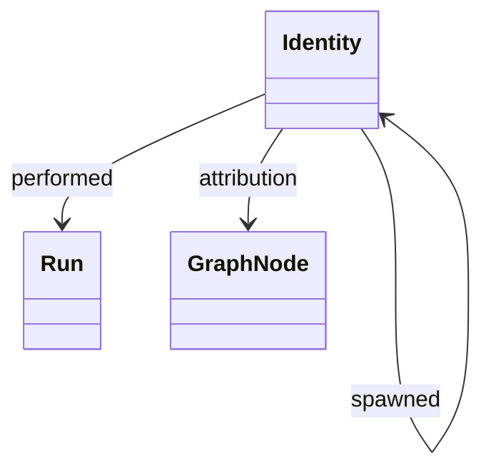

# @botlake/extension-identity

Native session identity, activity observations and attribution. Requires the `@botlake/core` peer package; no prerequisite extensions.

Select `"@botlake/extension-identity"` in workspace `extensions`, or import `identity()` for programmatic activation. Imports are inert. `nativeStartup` upserts deterministic identities from provider/native-session keys; `observeIdentity` records supported lifecycle metadata. `recordParticipation` links managed invocations or external sessions; `resolveIdentity`, `attribute` and `attribution` resolve provenance. Native parent evidence creates `spawned` edges.

`bl identity show [IDENTITY]` defaults to the caller's `BL_ACTOR`. Startup metadata defaults from `BL_AGENT_SEAT`, `BL_MODEL` and `BL_EFFORT`; `--agent-seat`, `--model` and `--thinking-level` override them. Defaults use only `ctx.env.bl`, never the lake environment. Explicit JSON `null` clears metadata. Programmatic `nativeStartup`/`observeIdentity` use only their supplied input.

## Relationships

`node-model.ts` declares `identityAttributes` and `identityRelations`, available from the package's public exports.

`spawned` links a parent native session to a child session; `performed` links an identity to a managed invocation or external session run. `attributed`, `reported` and `claimed` link an identity to records whose provenance it supplies. Participation does not confer process custody; activity is the last reported event, never process liveness.

Native client adapters are the separate `@botlake/identity` package. Observation never grants process ownership or implies task completion.
