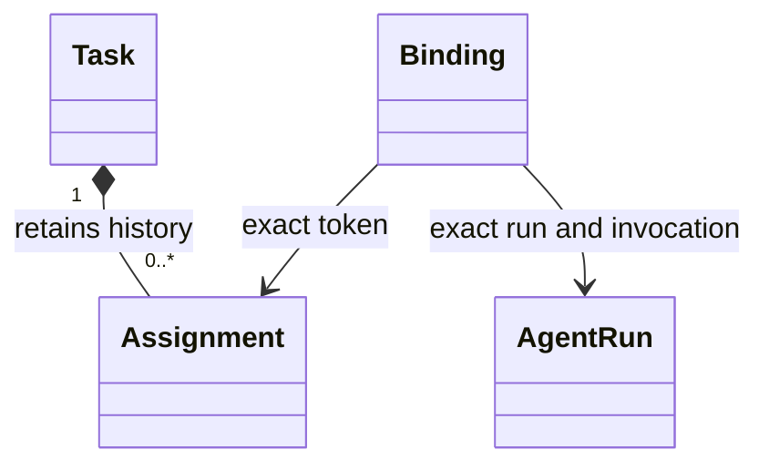

# @botlake/extension-work-agents

Optional liveness for assignments held by registered native agent identities. Select Work, Agents and Identity explicitly, then configure the native-session recheck interval:

```ts
import { workAgents } from "@botlake/extension-work-agents";

export default workAgents({ checkIntervalMs: 60_000 });
```

AFK task creation and claims automatically bind when Agents can resolve the assignee's run. Managed runs require the exact caller `BL_RUN_REFERENCE` and matching registered identity; a coordinator's run cannot bind another assignee. External native sessions require one matching, non-ended agent-audience run. Missing or ambiguous evidence leaves the assignment unbound; reclaiming the same assignment retries enrollment. HITL work stays unbound. Registration alone does not enroll old assignments.

Explicit binding and heartbeat remain available:

```sh
bl work-agent bind TASK RUN --assignment ASSIGNMENT
bl work-agent heartbeat TASK RUN --assignment ASSIGNMENT --by-identity IDENTITY
```

Agents supplies authoritative run evidence through `agentLiveness`. Managed custody settlement releases the matching assignment; managed runs have no inactivity deadline. Committed settlement evidence survives a retry changing the current run. After a missed event, a newer invocation on the latest run also proves the bound invocation settled; delayed old events cannot release a newer binding. A managed invocation can bind while custody remains unsettled, including uncertain cancellation; its lifecycle label alone does not determine release. Managed bindings are checked on run events and restart. External bindings are rechecked periodically and release when their native session reports ending. Already-ended native sessions cannot bind. A heartbeat can refresh the binding, using explicit attribution or `BL_ACTOR`, but neither its absence nor idle activity proves exit. Zombie/stalled-work policy remains deferred.

Both release paths fence on the assignment token. Managed bindings also match the invocation; external bindings match the run and native identity. Stale observations cannot release a newer assignment. HITL assignments and human-audience sessions cannot bind. Changing a bound task to HITL disables automatic release. Unbound assignments are untouched. Restart restores bindings and rechecks current evidence; no provider process is launched by this extension. Agents requires Flags as a transitive prerequisite.



Work owns assignments; Agents owns run evidence; Work Agents owns the private binding and release decision. `node-model.ts` exports `workAgentAttributes` and the binding value schema.

`bun scripts/work-agent-smoke.ts` verifies quiet ownership, delayed settlement/retry, uncertain cancellation, restart/rechecking and packaged managed settlement in disposable SQLite lakes. Provider execution uses a local deterministic fixture, not a live model account.
