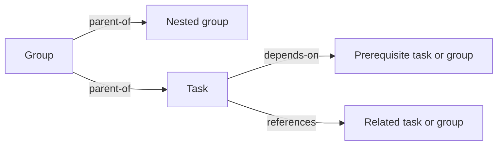

# @botlake/extension-work

Explicitly select Identity and Work. Imports are inert; `work()` selects the extension and `workStore(ctx)` exposes the same operations to other extensions.

```sh
bl prime work
bl work create "Delivery context" --kind group --description "Shared purpose and constraints"
bl work create "Investigate alternatives" --parent GROUP --description "Answer with supporting evidence"
bl work list --view available
bl work show TASK
bl work claim TASK
bl work update TASK --notes "Findings and supporting references"
bl work close TASK
```

Tasks are actionable leaves. Groups supply shared context and may contain groups/tasks, with one contextual parent per item. Group closure requires every contained task, including nested tasks, to be closed. Only tasks can be assigned. Groups can remain open after their tasks close; closure is explicit.

## Relationships

`node-model.ts` declares `workAttributes`, `workRelations` and stored-value schemas, available from the package's public exports.

`parent-of` is contextual containment; `depends-on` is readiness; `references` is a non-contextual connection. Group prerequisites do not propagate to members.



`link FROM TO --relation depends-on` adds a direct prerequisite task or group. An open item is ready when all its direct prerequisites are closed. Containment and references do not create prerequisites; a group prerequisite does not silently become a prerequisite of its members. Closing work neither asserts success nor completes dependents. `references` retains useful non-contextual connections without adding inherited instructions.

Defaults are AFK, planned, P2. P0 is immediate attention; P1–P4 decrease in urgency. `list --view human --assignee PERSON` shows ready HITL work routed to that person; filter `--origin planned|unplanned` for planned handoffs or interruptions. `available` excludes HITL, assigned and waiting work. `assigned` and `waiting` overlap. Assignment is responsibility, not proof of execution. Human assignments never expire automatically.

Criteria are optional. `criterion add TASK CONDITION` appends an immutable condition. `criterion resolve TASK CRITERION TEXT` records an assessment, including unmet or no longer required. Every added condition must be resolved before task closure; readiness is not a universal closure guard. Findings belong in notes; no global notes-presence rule applies.

`reopen ID --reason TEXT` is recovery, not new scope. It retains previous criterion resolutions and closure history. Reopen closed containing groups first. Use `criterion correct` to append a corrected assessment or `criterion reopen` to restore an open condition explicitly. Neither operation erases the original condition or prior assessments. Corrections may annotate closed work; reopening a condition requires an open task. Completed scope normally becomes new work.

Claim defaults to `BL_ACTOR`; competing owners must explicitly release before handoff. `release TASK --assignment-id TOKEN --reason TEXT` changes only the matching current assignment. Stale releases return `released: false`. Closure releases its assignment and preserves history. Optional [Work Agents](../work-agents/README.md) binds assignment tokens to managed agent liveness.

`show` includes the local brief, ancestor context, criteria, notes, prerequisites and references. `--history` expands assignment, criterion and recovery history. Group members and lists default to 20 summaries, maximum 100; continue at `nextOffset`. Pages are not snapshots. `list --search TEXT` searches titles, descriptions and notes, including closed work unless `--state` narrows it. Lists omit briefs and findings.

[Workflow](../workflow/README.md) publishes this same task/group model. Only explicit authored workflow actions advance execution; ordinary Work closure never does. No agents launch automatically.

Verify the packaged CLI against disposable SQLite lakes with `bun scripts/work-smoke.ts`.
