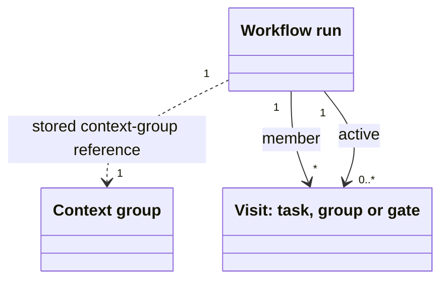

# @botlake/extension-workflow

Explicitly select Identity, Work and Workflow. Imports are inert; `workflows()` is the configured extension. There are no built-in workflows and no automatic agent launches.

Install compatible `xstate` and `zod` versions in the lake package. Workflow declares both as peers because lake definitions pass XState machines and Zod schemas into the extension.

## Model

A run records execution and is not a Work item. It points at one Work context group and publishes visits as Work tasks, context groups or gates. `workflow-member` retains every published visit; `workflow-active` marks only the current frontier. Context nesting follows Work's `parent-of` tree independently of execution membership; `start --parent` nests only the context group.



## Author

Use `bl about workflow` for authoring conventions and configuration; `bl prime workflow` is the execution runbook.

Keep definitions in `.botlake/workflows/NAME.ts` and register them explicitly in a configured local extension module. For example, `.botlake/workflows/review.ts`:

```ts
import { defineWorkflow } from "@botlake/extension-workflow";
import { setup } from "xstate";
import { z } from "zod";

export default defineWorkflow({
  name: "review",
  version: "1.0.0",
  description: "Review a change and record findings",
  inputSchema: z.object({ change: z.string() }),
  commandSchemas: { done: z.object({}) },
  runBrief: ({ change }) => ({ title: `Review ${change}`, description: "Record findings." }),
  machine: setup({}).createMachine({
    initial: "review",
    states: {
      review: {
        meta: {
          title: "Review change",
          commands: { done: "DONE" },
          task: () => ({ instructions: "Review the change and record findings." }),
        },
        on: { DONE: "done" },
      },
      done: { type: "final" },
    },
  }),
});
```

Register it from `.botlake/workflow.ts`:

```ts
import { workflows } from "@botlake/extension-workflow";

import review from "./workflows/review.ts";

export default workflows({ definitions: [review] });
```

Select `./.botlake/workflow.ts` and its Identity/Work prerequisites in `.botlake/package.json`. Importing a definition does not register it; `workflows()` registers an empty catalogue. Definition names must be unique lowercase kebab-case identifiers; versions must be full semantic versions.

Each definition requires `name`, `version`, `description`, `machine`, `inputSchema`, `commandSchemas` and `runBrief`; optionally `probes`, `describe`, `validateCommand` and `inputConstraints`. `runBrief` receives parsed input and returns a title and description for the run's context group. A titled XState state publishes Work: `meta.task` renders its instructions and optional task fields; `meta.commands` maps explicit choices to events. Commandless titled states publish groups. Task fields include `acceptanceCriteria: string[]`, notes, assignee, audience, origin and priority; Work applies its normal defaults.

`task.attributes` is an explicit JSON map copied verbatim onto the worker task node, after its prerequisite gates are attached, in the same publication transaction. Nested objects, arrays and nulls are retained. Work/Workflow namespaces (`work/*`, `workflow/*`) and declared immutable attribute keys are rejected. Commandless context groups cannot declare task attributes. Other arbitrary metadata remains inert in `workflow/meta`; it is not copied onto the node.

```ts
task: ({ context }) => ({
  instructions: `Review ${context.change}`,
  attributes: { "review/change": context.change, "review/dispatch": true },
});
```

Work probes are available to workflows without any separate extension selection. Pass `probes` to `defineWorkflow` to define workflow-owned probes; their keys are `NAME/PROBE`. A bare name prefers that workflow's probe and then a probe configured in Work.

A gate visit publishes one gate and maps selected statuses to XState events:

```ts
meta: {
  title: "Frontend CI is green",
  gate: ({ context }) => ({ probe: "ci-green", params: { sha: context.sha } }),
  on: { cleared: "CI_GREEN", exhausted: "CI_STUCK", dismissed: "CI_WAIVED" },
}
```

A mapped status advances the active visit once and supplies `{ type, data: { gate, status } }`. After each frontier publication commits, its active gates deliver their current mapped statuses, including initial `pending`, before the operation returns. Chained mappings publish each next frontier before advancing another gate. Failed status delivery identifies the committed run and leaves the visit unconsumed; inspection or a completion retry redelivers it without a restart. The exported `GateEventData` type pairs the gate ID with the full Work `GateStatus` snapshot: evidence, attempt counts, last failure, timestamps and attribution are retained where applicable. Guards and assignments can inspect `event.data.status` without another graph read. The same `{ gate, status }` is saved as the visit result data beside its status choice. Unmapped statuses leave it active. `workflow show` includes each active gate and status. A transition missed while the lake was down is delivered after activation.

A task can publish gates as its direct prerequisites. Work readiness is the whole contract: the task waits until every gate is closed.

```ts
meta: {
  title: "Announce release",
  task: ({ context }) => ({ instructions: `Announce ${context.version}` }),
  commands: { done: "DONE" },
  gates: ({ context }) => [
    { title: "Frontend CI is green", probe: "ci-green", params: { sha: context.sha } },
  ],
}
```

Re-entering the same gate state reuses its previous gate while that gate remains open. An exhausted reused gate starts a fresh round. Once the previous gate is closed, re-entry publishes a new gate. Leaving a gate state does not close its gate. Re-entering a worker task publishes a fresh task and its own prerequisite gates. See [gate escalation](examples/gate-escalation.ts) for an exhausted gate that creates an investigation task, then re-enters to retry or dismisses the gate and exits.

The [parallel](examples/parallel.ts) and [nested-machine](examples/nested-machines.ts) examples show branch-scoped events, joins and child actors. Install authored imports (`xstate`, `zod`) in the workspace. Internal worker nesting never makes a task a contextual parent: work attaches to the nearest context group. Execution membership is private and independent of the context tree.

## Work

```sh
bl prime workflow
bl workflow catalog NAME
bl workflow start NAME --input '{}'
bl workflow show RUN_ID
bl work show TASK_ID
bl work claim TASK_ID
bl workflow show TASK_ID
bl workflow complete TASK_ID CHOICE --data '{}'
```

Catalog lists only explicitly registered definitions; start requires a configured name. `start --parent GROUP` puts the new context group under an existing open group; the execution record itself is not a task or context member.

Run inspection returns pending authored actions and decision summaries, including closed-but-unconsumed tasks. `actionPending` describes execution, not task lifecycle. Tasks and decision history default to 20 entries, maximum 100. Continue using `taskPage.nextOffset` with `--offset`, or `historyPage.nextOffset` with `--history-offset`. Pages are not snapshots. Task inspection expands frozen instructions, choice schemas, original result and the shared Work detail/history.

`complete` explicitly submits an authored outcome. It validates the action schema and direct prerequisites, closes the task subject to its criteria, advances execution and renders the next frontier. Closure, assignment release, result, snapshot and a frozen publication intent commit together; rendering/validation failure rolls all of them back. A separate atomic transaction publishes the frontier with all prerequisites and task attributes. Probe-resolution or publication failure identifies the committed run in a `workflow-publication` error and leaves its checkpoint and pending intent available for reconciliation. Repeating the original choice and raw payload reconciles pending publication and is idempotent; a conflicting retry fails. Attribution uses the normalized invocation caller.

Ordinary `work close` **never advances execution**; an explicit action may be submitted afterward. Closing an agent run likewise neither completes Work nor submits an action. Reviews can close with unfavourable findings: branching uses the explicit authored choice, not the generic closed state. Revision loops publish fresh tasks and retain earlier findings; consumed visits cannot reopen.

Parallel branches advance independently. Departed generated groups close only when all contained tasks are closed. Execution can finish while ordinary follow-up tasks keep its context group open; an enclosing business group never closes automatically. Impediments are ordinary Work prerequisites, not a separate Workflow blockage or ownership ledger.

## Persistence

Runs save the definition's name and version and restore only when that exact version is configured. Authors must bump the version whenever changing a definition used by persisted runs, including its machine, renderers, schemas, probes or imported helpers. Source contents are not fingerprinted; changing code without changing its version is not detected. Restart the lake to load configuration changes. Missing definitions and version mismatches fail loudly. Full XState snapshots persist as JSON strings. Each checkpoint freezes the rendered frontier and durable logical visit identities before publication. Activation reconciles pending publication before replaying gate statuses; `workflow show` and `workflow complete` also reconcile it. Reconciliation neither reruns renderers nor duplicates published visits. Parallel retained visits keep their `workflow/identity`; loop re-entry gets a new identity, including when a gate reuses its Work node. Advancement and reconciliation serialize per run. Definition locators, published context/metadata and original results use native JSON attributes, including authored nulls. There is no migration, cancellation/replanning command, durable external-effect execution or implicit approval/merge policy.

Verify packed packages, real CLIs, nested/revision workflows and render-time rollback with `bun scripts/workflow-smoke.ts`. Verify gate evidence, attribute protection and real checkpoint/publication crashes in disposable SQLite lakes with `bun scripts/workflow-recovery-smoke.ts`.
