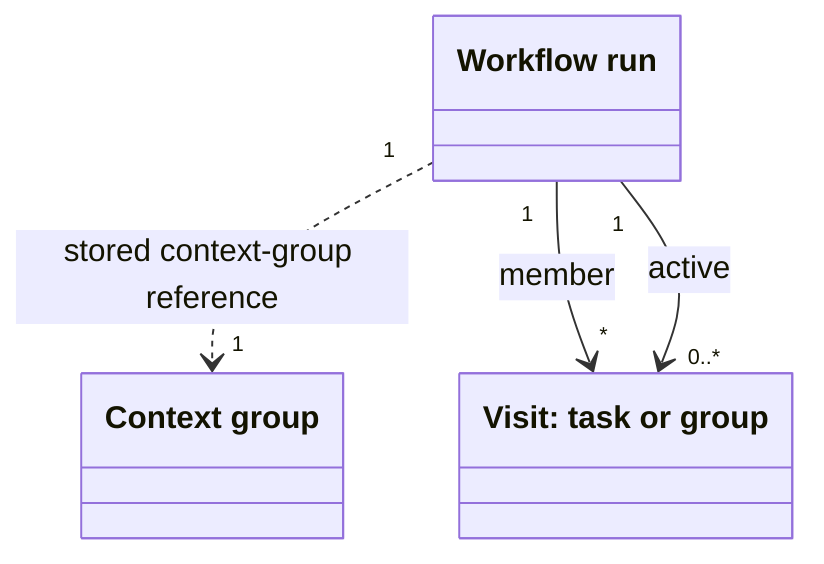

# @botlake/extension-workflow

Explicitly select Identity, Work and Workflow. Imports are inert; `workflows()` is the configured extension. There are no built-in workflows and no automatic agent launches.

## Model

A run records execution and is not a Work item. It points at one Work context group and publishes visits as Work tasks or context groups. `workflow-member` retains every published visit; `workflow-active` marks only the current frontier. Context nesting follows Work's `parent-of` tree independently of execution membership; `start --parent` nests only the context group.



## Author

Place trusted TypeScript in `.workflows/NAME/workflow.ts` alongside `workflow.toml`:

```toml
version = "1.0.0"
description = "What this process accomplishes"
run = "workflow.ts"
```

Export `machine`, `inputSchema`, `commandSchemas` and `runBrief`; optionally `describe`, `validateCommand` and `inputConstraints`. `runBrief` returns a title and description for the run's context group. A titled XState state publishes Work: `meta.task` renders its instructions and optional task fields; `meta.commands` maps explicit choices to events. Commandless titled states publish groups. Task fields include `acceptanceCriteria: string[]`, notes, assignee, audience, origin and priority; Work applies its normal defaults.

The [parallel](examples/parallel.ts) and [nested-machine](examples/nested-machines.ts) examples show branch-scoped events, joins and child actors. Install authored imports (`xstate`, `zod`) in the workspace. Internal worker nesting never makes a task a contextual parent: work attaches to the nearest context group. Execution membership is private and independent of the context tree.

## Work

```sh
bl prime workflow
bl workflow catalog NAME
bl workflow start NAME --input '{}'
bl workflow show RUN_ID
bl work show TASK_ID
bl work claim TASK_ID
bl workflow show TASK_ID
bl workflow complete TASK_ID CHOICE --data '{}'
```

Catalog and start also accept `--source FILE` instead of a name. `start --parent GROUP` puts the new context group under an existing open group; the execution record itself is not a task or context member.

Run inspection returns pending authored actions and decision summaries, including closed-but-unconsumed tasks. `actionPending` describes execution, not task lifecycle. Tasks and decision history default to 20 entries, maximum 100. Continue using `taskPage.nextOffset` with `--offset`, or `historyPage.nextOffset` with `--history-offset`. Pages are not snapshots. Task inspection expands frozen instructions, choice schemas, original result and the shared Work detail/history.

`complete` explicitly submits an authored outcome. It validates the action schema and direct prerequisites, closes the task subject to its criteria, advances/checkpoints execution and publishes subsequent work in one transaction. Failure rolls back every persistence effect, including assignment release. Repeating the original choice and raw payload is idempotent; a conflicting retry fails. Attribution uses the caller's `BL_ACTOR`.

Ordinary `work close` **never advances execution**; an explicit action may be submitted afterward. Closing an agent run likewise neither completes Work nor submits an action. Reviews can close with unfavourable findings: branching uses the explicit authored choice, not the generic closed state. Revision loops publish fresh tasks and retain earlier findings; consumed visits cannot reopen.

Parallel branches advance independently. Departed generated groups close only when all contained tasks are closed. Execution can finish while ordinary follow-up tasks keep its context group open; an enclosing business group never closes automatically. Impediments are ordinary Work prerequisites, not a separate Workflow blockage or ownership ledger.

## Persistence

Named definitions restore only with their exact version and folder fingerprint; explicit files use entry-file fingerprints. Changed already-imported modules require a lake restart. Full XState snapshots persist as JSON strings. There is no migration, cancellation/replanning command, durable external-effect execution or implicit approval/merge policy.

Verify packed packages, real CLIs, nested/revision workflows and transaction rollback in disposable SQLite lakes with `bun scripts/workflow-smoke.ts`.
